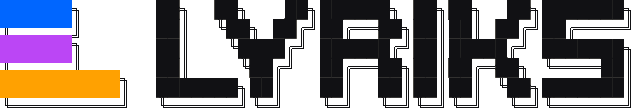

<div align="center">

<!-- Logo: paper/ink variants follow the GitHub light/dark theme -->
<picture>
  <source media="(prefers-color-scheme: dark)" srcset="docs/media/logo-encre.png">
  
</picture>

# Lyriks Community Edition

**From your code to a living spec.**

Free, open source, and it runs on your machine.

[](LICENSE)
[](https://github.com/lyriks-io/lyriks-community/actions/workflows/ci.yml)
[](https://discord.gg/s2v5yNR5aD)

[**Get your free key**](https://lyriks.io/get-started?utm_source=github&utm_medium=readme&utm_campaign=lce-launch) ·
[Docs](https://lyriks.io/docs?utm_source=github&utm_medium=readme&utm_campaign=lce-launch) ·
[First steps](https://lyriks.io/first-steps?utm_source=github&utm_medium=readme&utm_campaign=lce-launch) ·
[Discord](https://discord.gg/s2v5yNR5aD)


</div>

---

Lyriks is a self-hosted workspace that holds your product's features, rules, screens and data in one specification. Your AI coding client reads the code and writes that spec through MCP; you review it in the browser.

## Sound familiar?

- Nobody remembers why the code does what it does.
- The spec, if there ever was one, stopped matching the code long ago.
- AI agents write code without knowing what the product is supposed to do.

**Code is not the source of truth. It is the source of the implementation.**
Lyriks recovers the truth behind it, and keeps it alive.

## What you get

**360° mapping.** Features, rules, screens, data: your whole product, each element linked to its code and to your reference docs (Confluence, Jira…) when your AI client reaches them over MCP.

**Coherence, built in.** A graph, not a RAG: the engine checks the whole spec for gaps and contradictions, deterministically, and keeps track of where docs, tickets and code disagree. Same spec, same verdict.

**A living memory, not another .md file.** A structured map your AI agents work from, over MCP: Claude Code, Cursor, Copilot and any MCP client. Models come and go. Memory stays.

**Your spec stays with you.** Lyriks runs on your machine, with the LLM you choose, and sends nothing out on its own. The map belongs to you.

## Quick start

Three steps. One command to install.

**1. Install.** Get your free key on [lyriks.io/get-started](https://lyriks.io/get-started?utm_source=github&utm_medium=readme&utm_campaign=lce-launch), then run:

```bash
# Linux and macOS
curl -fsSL https://get.lyriks.io | sh
```

```powershell
# Windows, in PowerShell
irm https://get.lyriks.io/windows | iex
```

The installer checks your machine, offers to install Docker if it is missing, runs everything in containers and verifies itself. Open the address it prints, usually <http://localhost:3000>, and activate with your key. Something off? See [When it goes wrong](https://lyriks.io/docs?utm_source=github&utm_medium=readme&utm_campaign=lce-launch#trouble).

Lyriks images are built for x86-64. On a Mac with Apple Silicon they run through Rosetta, a little slower; Linux on ARM is not supported.

**2. Connect your AI client.** Point it at your install followed by `/mcp`. With Claude Code:

```bash
claude mcp add --scope user --transport http lyriks http://localhost:3000/mcp
```

Run `/mcp` in Claude Code and sign in. Cursor, Copilot and other MCP clients take the same URL. See the [MCP guide](docs/mcp.md).

**3. Get your spec out of your code.** Open your AI client in the repository you want to understand and ask:

> Using the Lyriks MCP and the lyriks-retrospec guide, create a project named "First spec" from this codebase. Use the source code as evidence and link the modelled behaviour back to it. Do not change the application's code.

Your client reads the whole repository and writes the spec; on a large codebase this takes a while and uses its tokens. Then open the project in Lyriks: your first spec is there. [First steps](https://lyriks.io/first-steps?utm_source=github&utm_medium=readme&utm_campaign=lce-launch#spec-from-code) shows how to read it and check it against your product.

<!-- "Coming from Unspaghettit?" callout, linking to the migration page, goes here. -->

## Community Edition and paid plans

The Community Edition is free and open source: one user and one project, for as long as you like. A second project opens with Solo Builder; projects kept from a paid plan stay listed, read-only. Start with one codebase, prove it, then grow.

| | Community Edition | Solo Builder | Team | Enterprise |
|---|:---:|:---:|:---:|:---:|
| Price | free | per project | per project | on request |
| Users | 1 | 1 | 5 per project | per contract |
| Active projects | 1 | 1 per project bought | 1 per project bought | per contract |
| Inactive projects | unlimited, read-only | unlimited, read-only | unlimited, read-only | per contract |
| 360° mapping (reverse specification) | ✓ | ✓ | ✓ | ✓ |
| Knowledge base and project memory over MCP | ✓ | ✓ | ✓ | ✓ |
| Change simulation and verification | | ✓ | ✓ | ✓ |
| Team collaboration | | | ✓ | ✓ |
| Rules proved for every value (solver) | | | | ✓ |
| Dedicated CSM and specific terms | | | | ✓ |
| Runs on your servers, with your LLM | ✓ | ✓ | ✓ | ✓ |
| Licence | AGPL-3.0 | commercial | commercial | commercial |

Want to go further? Simulate and verify your changes with Solo Builder, then collaborate on your projects with Team. [See pricing](https://lyriks.io/pricing?utm_source=github&utm_medium=readme&utm_campaign=lce-launch).

## What leaves your machine

- **Your code and your spec stay on your machine.** Projects are stored locally, in containers you control.
- **Your LLM, your tokens.** A connected AI client may send the code and spec it reads to its provider; its own data policy applies. Lyriks sends nothing beyond that. Local and sovereign models work.
- **Activation** uses the email address you gave on lyriks.io/get-started. The key is verified locally.
- **No telemetry.** Lyriks collects nothing about how you use it.
- **Installation** downloads images from `registry.lyriks.io`. After that, nothing leaves until you tick it at first start, and you can untick it any time in Settings: checking for new versions, online feedback, links to lyriks.io.

Read the [security page](https://lyriks.io/security?utm_source=github&utm_medium=readme&utm_campaign=lce-launch), or the installer scripts themselves before you run them: [install.sh](https://get.lyriks.io/install.sh), [install.ps1](https://get.lyriks.io/windows).

## Other ways to run it

<details>
<summary><b>Docker Compose</b></summary>

```bash
git clone https://github.com/lyriks-io/lyriks-community.git
cd lyriks-community
cp .env.example .env
# Generate two values, then uncomment and set the matching entries in .env:
openssl rand -hex 16    # POSTGRES_PASSWORD
openssl rand -hex 32    # LYRIKS_JWT_SECRET
docker compose up -d
```

Open <http://localhost:3000> and activate as above. The images come from `registry.lyriks.io`, pinned to the version you cloned. To update, back up the volumes and move to a newer checkout: see [Updates and backups](docs/getting-started.md#updates-and-backups). The installer automates this, with rollback.

</details>

<details>
<summary><b>Work on the code</b></summary>

Requirements: Node 22, pnpm 10.6.3 (`corepack enable`), PostgreSQL 16.

```bash
git clone https://github.com/lyriks-io/lyriks-community.git
cd lyriks-community
corepack enable
pnpm install
cp .env.example .env        # set LYRIKS_PG_URL to your PostgreSQL
pnpm dev:community          # the app
pnpm dev:mcp                # the MCP gateway, in a second terminal
```

If the app does not run on port 5173 (8173 under WSL), set `LYRIKS_BASE_URL` to its address in the second terminal before `pnpm dev:mcp`.

Development needs no key. Run `pnpm check && pnpm test` before submitting a change. The [docs](docs/README.md) cover configuration, architecture and the release process.

</details>

## Community and support

- **Questions, ideas, feedback:** [Discord](https://discord.gg/s2v5yNR5aD). The team is there.
- **Bugs:** [open an issue](https://github.com/lyriks-io/lyriks-community/issues). [SUPPORT.md](SUPPORT.md) says what to include.
- **Security issues:** [SECURITY.md](SECURITY.md), never a public issue.
- **Anything else:** contact@lyriks.io. We read every message.

## Contributing

Bug reports, documentation fixes and code are welcome. Start with [CONTRIBUTING.md](CONTRIBUTING.md) and the engineering rules in [AGENTS.md](AGENTS.md).

Each commit needs a DCO sign-off (`git commit -s`). With your first pull request you also accept the [CLA](CLA.md), which lets us distribute contributions under other terms, including the commercial licence. Everyone follows the [Code of Conduct](CODE_OF_CONDUCT.md).

## Licence

Copyright (C) 2026 Lyriks. The Community Edition is licensed under the GNU Affero General Public License v3.0 only (`AGPL-3.0-only`), see [LICENSE](LICENSE). "Lyriks" is a trademark; the licence covers the code, not the name.

<div align="center">
<br>
<b>Keep your software in tune!</b>
</div>
